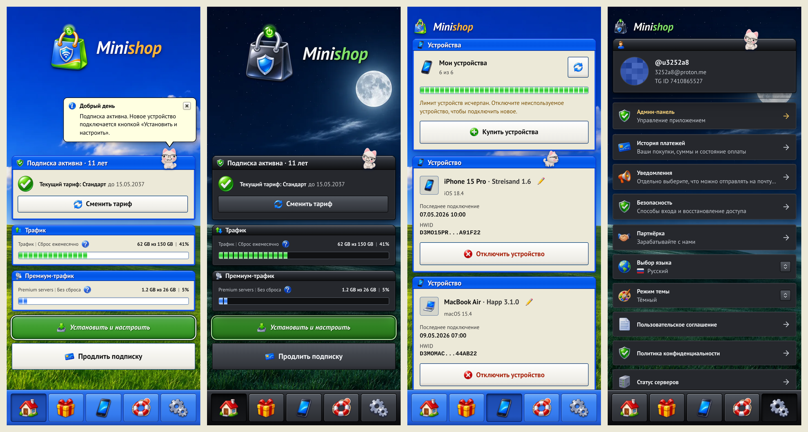
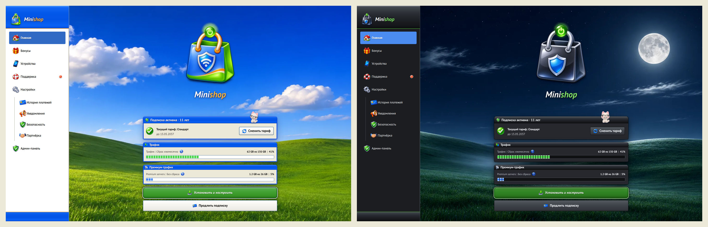

# Luna — тема для Remnawave Minishop

Тема в стиле Windows XP Luna для веб-аппа [Remnawave Minishop](https://github.com/3252a8/remnawave-minishop): окна со стеклянными синими заголовками, зелёная кнопка «Пуск» на главных действиях, панель задач вместо нижнего меню, трафик зелёными блоками, свои холмы на фоне. Две версии — светлая **Luna** и тёмная **Royale Noir** (холмы ночью под полной луной). В комплекте свой логотип Minishop и котик-помощник.

## Установка

**Из этого репозитория:** Админка → Внешний вид → Добавить темы → вставить ссылку на репозиторий → предпросмотр → Активировать.

**Из архива:** скачать репозиторий ZIP-архивом (Code → Download ZIP) и перетащить в «Добавить темы».

- Ключ темы `omibranch-luna`, в библиотеке — «Luna». Переключатель «Режим темы» работает (light / dark).
- Админка остаётся на стандартной теме.
- Котик-помощник — отдельный модуль эффектов: включается флажком «JavaScript» при установке. Без него тема полностью рабочая. Кот ходит по заголовкам окон, садится на то, что вы читаете, подсказывает по реальным данным экрана и никогда не закрывает кнопки оплаты. Нажмите на кота: «Поспи» / «Спрячься». Выключить эффекты: штатная кнопка или `?theme_effects=off`.
- Логотип темы заменяет загруженный в админке; чтобы вернуть свой, удалите блок «v1.1 · Minishop logo» в конце `omibranch-luna/theme.css`.

Подробности — в [omibranch-luna/README.md](omibranch-luna/README.md).

## Автор

Тема сделана дизайнером **Omibranch** — упаковка VPN-ботов, мини-аппов, баннеры и логотипы. Хотите своё оформление витрины: [t.me/omibranch](https://t.me/omibranch) · [omibranch.uk](https://omibranch.uk)
